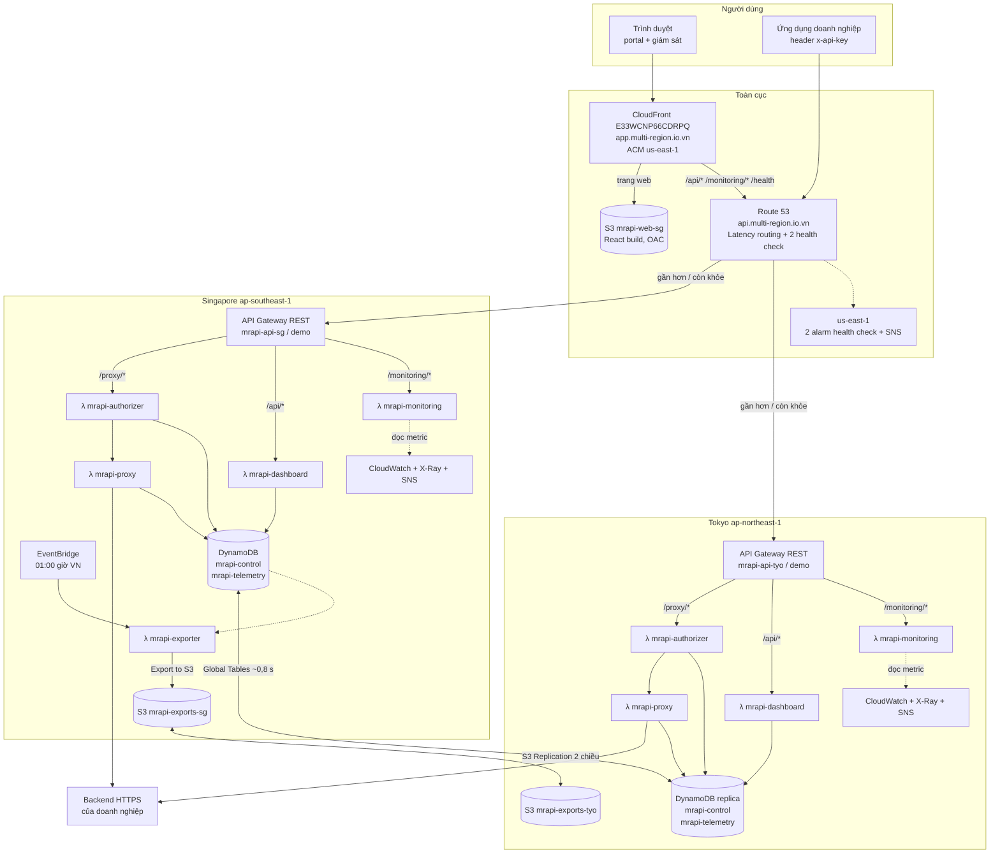
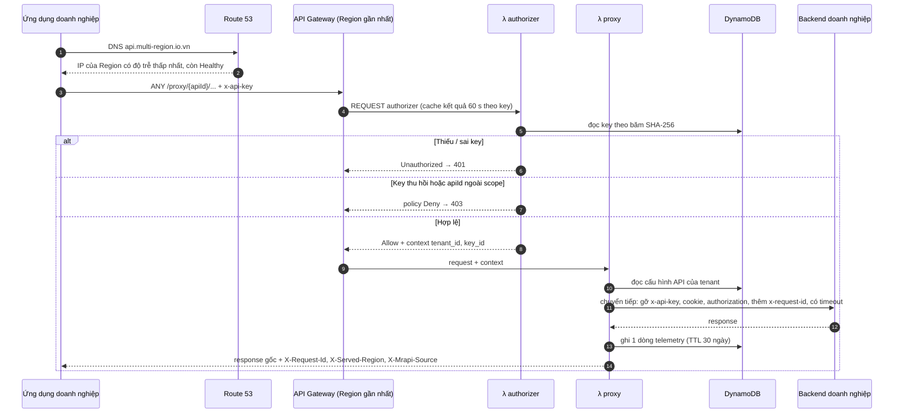
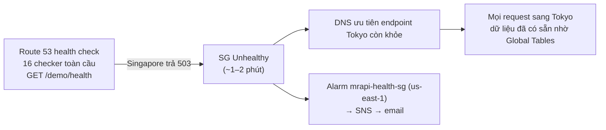

# Multi-Region API Platform

Gateway API cho nhiều doanh nghiệp, chạy **active-active ở hai AWS Region**: Singapore (`ap-southeast-1`) và Tokyo (`ap-northeast-1`).

## Thông tin nhóm thực hiện

Nhóm G17, môn Điện toán đám mây.

| STT | Họ và tên | MSSV | Vai trò | 
|-----|-----------|------|---------|
| 1 | Đặng Xuân Tùng | 24020350 | Nhóm trưởng | 
| 2 | Nguyễn Đức Minh | 24020233 | Thành viên | 
| 3 | Phạm Văn Toan | 22028208 | Thành viên | 
| 4 | Nguyễn Thế Nhân | 24020257 | Thành viên |

## Tổng quan hệ thống
Doanh nghiệp đăng ký backend của mình trên portal và nhận API key có phạm vi. Ứng dụng của họ gọi `https://api.multi-region.io.vn/proxy/{apiId}/...`, và gateway sẽ:

1. Kiểm tra key.
2. Chuyển request tới backend.
3. Ghi telemetry.
4. Trả kết quả.

Route 53 chọn endpoint theo latency routing và trạng thái health check; kết quả còn phụ thuộc DNS resolver và bộ nhớ đệm DNS. Khi một Region hỏng, lưu lượng tự chuyển sang Region còn lại.

| | |
|---|---|
| Portal doanh nghiệp | https://app.multi-region.io.vn/portal |
| Trang giám sát | https://app.multi-region.io.vn/ |
| API (latency routing) | https://api.multi-region.io.vn |
| Trạng thái | Đã triển khai đủ hai Region.  |

---

## Giới thiệu đề tài

**Tên đề tài: Xây dựng nền tảng API đa doanh nghiệp trên AWS theo kiến trúc Multi-Region Active-Active.**

Trong mô hình triển khai một Region, sự cố tại khu vực đó có thể làm gián đoạn toàn bộ điểm truy cập API. Người dùng ở xa cũng có thể chịu độ trễ cao hơn. Khi nhiều doanh nghiệp cùng sử dụng một nền tảng, hệ thống còn cần quản lý tài khoản, giới hạn quyền truy cập tới từng backend, phân biệt dữ liệu từng doanh nghiệp và theo dõi chất lượng phục vụ.

Đề tài xây dựng một gateway dùng chung: doanh nghiệp giữ backend HTTPS của mình, đăng ký địa chỉ backend trên portal, rồi cấp API key cho ứng dụng. Gateway kiểm tra quyền và chuyển tiếp request tới backend tương ứng. Hai cụm serverless tại Singapore và Tokyo cùng hoạt động, kết hợp Route 53 để định tuyến và DynamoDB Global Tables để đồng bộ dữ liệu.

### Mục tiêu

- Cung cấp một địa chỉ API thống nhất cho ứng dụng tích hợp.
- Phục vụ đồng thời từ hai Region và chuyển lưu lượng khi health check phát hiện sự cố.
- Quản lý tài khoản doanh nghiệp, phiên đăng nhập, API đích và API key có scope.
- Cách ly cấu hình và telemetry theo tenant, chặn truy cập ngoài phạm vi.
- Quan sát request, lỗi, độ trễ, replication và sự cố qua giao diện giám sát.
- Xuất telemetry định kỳ ra S3, duy trì bản sao ở Region thứ hai.
- Lưu mã nguồn, cấu hình tham khảo và bằng chứng kiểm thử để người khác có thể tìm hiểu và tái dựng.

### Đối tượng sử dụng và phạm vi

| Đối tượng | Cách sử dụng |
|---|---|
| Doanh nghiệp tích hợp | Đăng ký tài khoản, khai báo backend, tạo/thu hồi key và xem usage của mình |
| Ứng dụng khách | Gọi `/proxy/{apiId}/...` với `x-api-key` |
| Người vận hành | Theo dõi dashboard, alarm, health check, log và trace |
| Người đọc đồ án | Nghiên cứu kiến trúc, cấu hình, kịch bản kiểm thử và báo cáo |

Nền tảng không tự triển khai backend nghiệp vụ của doanh nghiệp. Khả năng dự phòng hai Region bảo vệ lớp gateway và các dữ liệu được replica; nếu backend đích chỉ có một nơi và bị lỗi thì gateway vẫn có thể trả lỗi upstream. Frontend hiện có một S3 origin tại Singapore, vì vậy khả năng chịu sự cố của frontend cần được đánh giá riêng với API.

### Công nghệ chính

| Nhóm công nghệ Cloud | Dịch vụ AWS | Vai trò trong hệ thống |
|---|---|---|
| Xử lý serverless | AWS Lambda | Chạy proxy, authorizer, API portal, monitoring và exporter tại các Region theo thiết kế |
| Cổng API | Amazon API Gateway REST | Tiếp nhận request, tích hợp Lambda và xác thực API key qua authorizer |
| Định tuyến đa Region | Amazon Route 53 | Latency routing, health check và chuyển lưu lượng khi endpoint lỗi |
| Cơ sở dữ liệu đa Region | Amazon DynamoDB Global Tables | Lưu và sao chép tài khoản, phiên, cấu hình API, API key và telemetry |
| Lưu trữ đối tượng | Amazon S3 | Lưu bản build frontend, dữ liệu export và bản sao liên Region |
| Phân phối nội dung | Amazon CloudFront | Phục vụ frontend qua CDN và chuyển tiếp các đường dẫn API |
| Chứng chỉ HTTPS | AWS Certificate Manager (ACM) | Quản lý chứng chỉ TLS cho domain frontend và API |
| Giám sát và cảnh báo | Amazon CloudWatch, Amazon SNS | Thu thập metric, log, tạo alarm và gửi thông báo |
| Truy vết phân tán | AWS X-Ray | Theo dõi luồng xử lý request qua API Gateway và Lambda |
| Lập lịch | Amazon EventBridge | Kích hoạt Lambda exporter theo lịch |
| Phân quyền | AWS Identity and Access Management (IAM) | Quản lý role, policy và quyền truy cập tài nguyên |
| Quản lý ngân sách | AWS Budgets | Theo dõi ngân sách và cảnh báo chi phí |

<sub><strong>Backend:</strong> JavaScript ESM (Node.js), AWS SDK for JavaScript v3. <strong>Frontend:</strong> React 19, TypeScript, Vite, Tailwind CSS, React Router, TanStack Query và Recharts.</sub>

<sub><strong>Công cụ hỗ trợ:</strong> node:test, Vitest, Testing Library và script E2E để kiểm thử; Node.js + Cloudflare Tunnel cho ứng dụng tích hợp mẫu trong project_node_shop/.</sub>

## Mục lục

- [Thông tin nhóm thực hiện](#thông-tin-nhóm-thực-hiện)
- [Giới thiệu đề tài](#giới-thiệu-đề-tài)

1. [Kiến trúc](#1-kiến-trúc)
2. [Luồng xử lý request](#2-luồng-xử-lý-request)
3. [Dịch vụ AWS sử dụng](#3-dịch-vụ-aws-sử-dụng)
4. [Tổ chức thư mục](#4-tổ-chức-thư-mục)
5. [API và mô hình dữ liệu](#5-api-và-mô-hình-dữ-liệu)
6. [Kiểm thử](#6-kiểm-thử)
7. [Kết quả kiểm thử và nghiệm thu](#7-kết-quả-kiểm-thử-và-nghiệm-thu)
8. [Bảo mật](#8-bảo-mật)
9. [Giới hạn đã biết](#9-giới-hạn-đã-biết)
10. [Tài liệu tham khảo](#10-tài-liệu-tham-khảo)
11. [Tích hợp ứng dụng](#11-tích-hợp-ứng-dụng)
12. [Xử lý lỗi thường gặp](#12-xử-lý-lỗi-thường-gặp)
13. [Hướng phát triển](#13-hướng-phát-triển)

---

## 1. Kiến trúc

Sơ đồ chi tiết dạng Mermaid:



**Ý tưởng chính**

- **Active-active:** cả hai Region cùng phục vụ. Một bản code Lambda được deploy giống nhau ở hai nơi.
- **Dữ liệu dùng chung:** tài khoản, API đích, API key và telemetry nằm trong DynamoDB Global Tables. Dữ liệu được sao chép bất đồng bộ. Key tạo hoặc thu hồi ở Singapore sẽ có hiệu lực ở Tokyo sau khi replica cập nhật; số đo trong báo cáo là kết quả thử nghiệm, không phải cam kết độ trễ.
- **Định tuyến:** Route 53 chọn Region theo độ trễ. Health check gọi `/demo/health` của từng Region; Region nào lỗi thì bị loại khỏi DNS.
- **Lưu trữ lâu dài:** mỗi đêm EventBridge gọi Lambda exporter để xuất bảng telemetry ra S3 Singapore. S3 Replication chép sang Tokyo.
- **Frontend:** một bản React duy nhất trên S3, phục vụ qua CloudFront. Các đường dẫn API đi tiếp qua `api.multi-region.io.vn`, nên frontend cũng được hưởng latency routing và failover.

---

## 2. Luồng xử lý request

### 2.1 Ứng dụng doanh nghiệp gọi API qua gateway



Mã lỗi do gateway tự trả:

| Mã | Khi nào |
|---|---|
| `401` | Thiếu key, sai định dạng, không tồn tại |
| `403` | Key đã thu hồi, gọi API ngoài scope hoặc của tenant khác, API đích đang tắt (`API_DISABLED`) |
| `502` `UPSTREAM_UNREACHABLE` | Không kết nối được backend (DNS, TLS, mạng) |
| `504` `UPSTREAM_TIMEOUT` | Backend trả lời quá thời gian cho phép |
| `400` | Đăng ký API đích trỏ vào địa chỉ nội bộ (`127.0.0.1`, `169.254.169.254`, `localhost`) hoặc dùng `http://` |

Nếu backend tự trả `4xx` hoặc `5xx`, gateway giữ nguyên mã đó và đánh dấu header `X-Mrapi-Source: upstream`.

### 2.2 Người dùng mở portal

```text
Trình duyệt → app.multi-region.io.vn (CloudFront)
  ├─ /, /portal, /regions, ...   → S3 mrapi-web-sg (CloudFront Function mrapi-spa-router trả index.html)
  └─ /api/*, /monitoring/*, /health → api.multi-region.io.vn → Route 53 → API Gateway Region gần nhất
```

Portal đăng nhập bằng email và mật khẩu, nhận token phiên rồi gửi `Authorization: Bearer <token>` khi gọi `/api/*`. Phiên lưu trong DynamoDB nên đăng nhập ở Region này vẫn dùng được ở Region kia.

### 2.3 Failover



Đã đo 3 lần bằng cách bật biến môi trường `HEALTH_FORCE_FAIL=true` trên `mrapi-proxy` Singapore ([failover.md](docs/reports/failover.md)).

---

## 3. Dịch vụ AWS sử dụng

| Dịch vụ | Singapore | Tokyo | Toàn cục / us-east-1 | Vai trò |
|---|---|---|---|---|
| **API Gateway** (REST) | `mrapi-api-sg` `43vakggyh5`, stage `demo` | `mrapi-api-tyo` `n39r5pits8`, stage `demo` | Custom domain `api.multi-region.io.vn` ở cả hai | Cửa vào, gắn authorizer cho `/proxy/*` |
| **Lambda** (Node.js 24, arm64, X-Ray Active) | proxy, authorizer, dashboard, monitoring, exporter | proxy, authorizer, dashboard, monitoring | | Xử lý nghiệp vụ |
| **DynamoDB** Global Tables | `mrapi-control`, `mrapi-telemetry` | replica của hai bảng | | Dữ liệu dùng chung, PITR + deletion protection, TTL `expiresAt` |
| **S3** | `mrapi-exports-sg`, `mrapi-web-sg` | `mrapi-exports-tyo` | | Export telemetry (replication 2 chiều, lifecycle), hosting web |
| **EventBridge** | `mrapi-export-daily` `cron(0 18 * * ? *)` | | | Lịch chạy exporter |
| **Route 53** | | | Zone `multi-region.io.vn`, 2 latency record + 2 health check | Định tuyến và failover |
| **CloudFront** | | | `E33WCNP66CDRPQ`, OAC, function `mrapi-spa-router` | Phân phối web, chuyển tiếp API |
| **ACM** | Cert API | Cert API | Cert frontend (us-east-1) | HTTPS |
| **CloudWatch** | 6 alarm, dashboard `mrapi-overview` | 5 alarm | 2 alarm health check | Metric, log (giữ 14 ngày), alarm |
| **SNS** | `mrapi-alerts` | `mrapi-alerts` | `mrapi-alerts` | Email cảnh báo |
| **X-Ray** | Tracing Lambda + stage | Tracing Lambda + stage | | Truy vết request |
| **IAM** | | | 6 role riêng cho từng Lambda + 2 role S3 replication, permission boundary | Phân quyền tối thiểu |
| **Budgets** | | | `mrapi-monthly` 10 USD | Kiểm soát chi phí |


---

## 4. Tổ chức thư mục

```text
aws/
├── src/                     Backend: code các Lambda (Node.js ESM, một bản cho cả hai Region)
├── monitoring-web/          Frontend React: portal doanh nghiệp + trang giám sát
├── tests/                   Unit test, E2E trên AWS thật, kịch bản kiểm thử
├── scripts/                 Đóng gói Lambda, so cấu hình hai Region
├── config/                  Tên, ID, URL tài nguyên từng Region (không có secret)
├── infra/                   Cấu hình AWS đọc lại từ Console, theo từng dịch vụ
├── project_node_shop/       Web CRUD sản phẩm mẫu (Node): một "doanh nghiệp" gọi API qua gateway
├── docs/                    Thiết kế, runbook, báo cáo, bằng chứng
└── artifacts/               ZIP Lambda và file build sinh ra (bị .gitignore)
```

### 4.1 `src/` — Backend Lambda

```text
src/
├── package.json             Script: test, package, test:e2e, test:e2e:proxy, test:telemetry
├── api/                     → Lambda mrapi-proxy
│   ├── index.mjs            Handler: GET /health (kiểm DynamoDB; HEALTH_FORCE_FAIL=true → 503) và ANY /proxy/{apiId}/{proxy+}
│   ├── proxy.mjs            Chuyển tiếp request tới backend doanh nghiệp, lọc header, timeout, ghi telemetry
│   ├── geo.mjs              Suy ra quốc gia client từ IP bằng GeoLite2 offline; chỉ lưu mã quốc gia, không lưu IP
│   └── target.mjs           Chặn SSRF: kiểm IP thật lúc mở kết nối (chống DNS rebinding), cấm mạng nội bộ
├── authorizer/
│   └── index.mjs            → Lambda mrapi-authorizer: REQUEST authorizer, kiểm x-api-key (băm SHA-256) và scope apiIds
├── dashboard/               → Lambda mrapi-dashboard: API của portal (/api/*)
│   ├── index.mjs            Đăng ký, đăng nhập (scrypt), phiên Bearer, API key, thống kê usage, trạng thái Region, CORS
│   ├── apis.mjs             CRUD API đích của doanh nghiệp (kiểm URL backend hợp lệ)
│   ├── report.mjs           Báo cáo theo tenant: lọc theo key/Region, percentile độ trễ, theo quốc gia
│   ├── demo-failover.mjs    /api/demo/failover: giả lập một Region lỗi (chỉ /health trả 503), có hạn giờ
│   └── demo-geo.mjs         /api/demo/geo: Route 53 TestDNSAnswer theo nước + request HTTPS thật tới IP được chọn
├── monitoring/              → Lambda mrapi-monitoring: /monitoring/*
│   ├── index.mjs            Đọc CloudWatch hai Region, Route 53, S3 replication; metric thiếu trả "missing", không bao giờ trả 0 giả
│   ├── report-auth.mjs      Kiểm phiên portal và key còn hoạt động trước khi trả báo cáo; số liệu hạ tầng chỉ cho admin
│   └── README.md            Cấu hình MONITORING_CONFIG, quyền IAM cần có
├── exporter/
│   └── index.mjs            → Lambda mrapi-exporter: gọi DynamoDB ExportTableToPointInTime ra S3 SG, ClientToken theo ngày
├── probe/
│   └── index.mjs            → Lambda mrapi-geo-probe (us-east-1, Function URL): gửi request thật từ Mỹ tới /health
└── shared/
    ├── lib.mjs              Client DynamoDB, tên bảng, json(), routeOf(), sha256, so sánh an toàn (timingSafeEqual), khóa PK/SK
    ├── errors.mjs           Mã lỗi gateway dùng chung
    └── outage.mjs           Bản ghi HEALTH/SIMULATED_OUTAGE cho demo failover
```

| Lambda | Thư mục | Handler | Route | Region |
|---|---|---|---|---|
| `mrapi-proxy` | `src/api` | `api/index.handler` | `GET /health`, `ANY /proxy/{apiId}/{proxy+}` | SG, Tokyo |
| `mrapi-authorizer` | `src/authorizer` | `authorizer/index.handler` | Authorizer cho `/proxy/*` | SG, Tokyo |
| `mrapi-dashboard` | `src/dashboard` | `dashboard/index.handler` | `GET /`, `ANY /api/{proxy+}` | SG, Tokyo |
| `mrapi-monitoring` | `src/monitoring` | `monitoring/index.handler` | `GET /monitoring/{proxy+}` | SG, Tokyo |
| `mrapi-exporter` | `src/exporter` | `exporter/index.handler` | EventBridge, không có route | Chỉ SG (thiết kế) |
| `mrapi-geo-probe` | `src/probe` | `probe/index.handler` | Lambda Function URL | Chỉ us-east-1, phục vụ demo định tuyến |

### 4.2 `monitoring-web/` — Frontend React

React 19 + TypeScript + Vite + Tailwind + TanStack Query. Một bản build phục vụ cả portal lẫn trang giám sát.

```text
monitoring-web/
├── index.html, vite.config.ts, tsconfig.json, package.json
├── .env.example             VITE_PORTAL_API_URL, VITE_MONITORING_API_URL, VITE_DEFAULT_DATA_MODE (mock | live)
├── public/samples/          project-mau-mrapi.zip — project mẫu cho doanh nghiệp tải về
├── docs/integration/        Hợp đồng backend giám sát (backend-api.md) và hướng dẫn nối từng dịch vụ AWS
└── src/
    ├── main.tsx, App.tsx    Khởi tạo React, router
    ├── app/                 data.tsx (chọn provider live/mock), settings.tsx (cài đặt lưu trình duyệt)
    ├── components/          Layout (sidebar), Toolbar, charts, ui (thẻ, bảng, badge)
    ├── data/                provider.ts (interface), providers.ts (HttpProvider gọi /monitoring/*, MockProvider),
    │                        sources.ts, deployment.ts, validation.ts, mock/generator.ts (dữ liệu demo có nhãn)
    ├── domain/              types.ts (kiểu dữ liệu giám sát), status.ts (tính Healthy/Degraded), format.ts, range.ts
    ├── pages/               Một file cho mỗi trang (bảng dưới)
    ├── portal/              client.ts (gọi /api/*), IntegrationGuide, RequestSimulator, SampleWalkthrough,
    │                        GuideDiagrams, DemoRequest, Snippet, demo.ts (chế độ "Trải nghiệm demo" trong trình duyệt)
    └── test/                setup.ts, render.tsx cho Vitest
```

| Đường dẫn | Trang | Nội dung |
|---|---|---|
| `/portal` | PortalPage | Đăng ký, đăng nhập; tab Tổng quan (lượt gọi, lỗi, theo Region, theo key), API đích, API key, Hướng dẫn tích hợp |
| `/demo` | DemoPage | Tự bấm demo: request theo quốc gia và giả lập một Region lỗi (cần đăng nhập) |
| `/` | OverviewPage | System Overview: sức khỏe hai Region, request, error rate, độ trễ |
| `/regions` | RegionsPage | So sánh Singapore và Tokyo, health check Route 53, replication |
| `/routing` | RoutingPage | Request theo quốc gia và Region phục vụ |
| `/errors` | ErrorsPage | Phân loại lỗi gateway và upstream |
| `/apis` | ApisPage | Thống kê theo endpoint |
| `/incidents` | IncidentsPage | Failover và sự cố (alarm, health check) |
| `/infrastructure` | InfrastructurePage | Sơ đồ tài nguyên đã triển khai |
| `/sources` | SourcesPage | Từng nguồn dữ liệu: đã kết nối, thiếu dữ liệu hay chưa cấu hình |
| `/settings` | SettingsPage | URL backend, chế độ dữ liệu demo hoặc live |

Các trang giám sát (từ `/` đến `/sources`) cần đăng nhập portal và có ít nhất một API key còn hoạt động; chưa đăng nhập thì trang mời xem dữ liệu demo có nhãn.

### 4.3 `tests/` — Kiểm thử

```text
tests/
├── control-plane/           Unit test (node:test), chạy bằng `npm test --prefix src`
│   ├── authorizer.test.mjs  401/403/Allow, scope, key thu hồi
│   ├── proxy.test.mjs       Chuyển tiếp, lọc header, timeout, lỗi upstream, telemetry
│   ├── portal.test.mjs      Đăng ký, đăng nhập, phiên, CRUD API đích, key
│   ├── usage.test.mjs       Thống kê theo Region và theo key
│   ├── health.test.mjs      /health, HEALTH_FORCE_FAIL
│   ├── exporter.test.mjs    Export idempotent theo ngày
│   └── frontend.test.mjs    GET / chuyển tới portal, CORS preflight
├── monitoring/handler.test.mjs  Đọc metric hai Region, S3 replication đúng Region đích, xử lý thiếu dữ liệu
├── e2e/                     Chạy trên AWS thật, tạo dữ liệu thử có tiền tố E2E_TAG
│   ├── control-plane.mjs    Đăng ký/đăng nhập, cách ly tenant, chặn URL nội bộ
│   ├── proxy.mjs            Ca D2–D6: key đúng/sai/thiếu/thu hồi, scope, backend lỗi/chậm
│   ├── acceptance-extra.mjs Hai tenant, hai Region, 502, usage đếm đúng
│   └── revoke-cross-region.mjs  Đo thời gian thu hồi key SG↔Tokyo
├── telemetry/telemetry-table.mjs   Trên bảng thật: ghi, query theo tenant/thời gian, GSI1 lỗi, TTL rồi tự xóa (npm run test:telemetry)
└── failover/, replication/, security/   README mô tả kịch bản kiểm thử thủ công
```

### 4.4 `scripts/`

| File | Chức năng |
|---|---|
| `package-lambdas.mjs` | Chạy bởi `npm run package --prefix src`. Đóng gói từng Lambda kèm `shared/` thành `artifacts/lambda/<tên>.zip`, in handler cần đặt |
| `check-region-parity.mjs` | Đọc cấu hình Lambda hai Region (qua AWS CLI) và báo khác biệt giữa Singapore và Tokyo |

### 4.5 `config/`

| File | Nội dung |
|---|---|
| `demo/ap-southeast-1.json`, `demo/ap-northeast-1.json` | Tên bảng, tên Lambda, API ID, `baseUrl` (gồm stage), bucket export của từng Region |
| `demo/global.json` | Domain, hosted zone, health check ID, ARN chứng chỉ ACM, CloudFront, ARN role IAM |
| `project.example.json` | Mẫu để dựng lại ở tài khoản khác |

Các handler Lambda lấy cấu hình vận hành từ biến môi trường; chúng dùng cho script E2E và để các thành viên tra cứu. Cấu hình thật của Lambda là biến môi trường trên AWS.

### 4.6 `infra/` — Cấu hình hạ tầng

Các file chủ yếu là JSON cấu hình được xuất từ AWS và tài liệu thao tác trên Console/CloudShell. Đây là hồ sơ tham khảo để dựng lại, không phải bộ Terraform hay một lệnh tự động triển khai toàn hệ thống. Khi dùng tài khoản khác, phải thay ARN, account ID, domain, tên bucket và các liên kết tài nguyên.

| Thư mục | Nội dung |
|---|---|
| [`apigateway/`](infra/apigateway/README.md) | REST API, route, stage, authorizer, account (CloudWatch role) của từng Region |
| [`lambda/`](infra/lambda/README.md) | Config, tag, resource policy của 9 hàm |
| [`dynamodb/`](infra/dynamodb/README.md) | Schema, GSI, TTL, replica, PITR, backup |
| [`s3/`](infra/s3/README.md) | Versioning, mã hóa, replication 2 chiều, lifecycle, bucket web |
| [`cloudfront/`](infra/cloudfront/README.md) | Distribution, behavior, OAC, function SPA router, bucket policy |
| [`route53/`](infra/route53/README.md) | Latency record, health check, export hosted zone |
| [`iam/`](infra/iam/README.md) | Role, trust, permission policy, boundary `mrapi-workload-boundary` |
| [`monitoring/`](infra/monitoring/README.md) | Alarm, log group, metric filter, SNS, Budget |
| [`eventbridge/`](infra/eventbridge/README.md) | Rule `mrapi-export-daily` |
| [`acm/`](infra/acm/README.md), [`xray/`](infra/xray/README.md), [`quotas/`](infra/quotas/README.md) | Chứng chỉ, sampling rule, quota Lambda |
| [`DEPLOYED_STATE.md`](infra/DEPLOYED_STATE.md) | Tổng hợp trạng thái đã triển khai và kết quả nghiệm thu |

### 4.7 `project_node_shop/` — Doanh nghiệp mẫu

Web CRUD sản phẩm bằng Node, đóng vai "doanh nghiệp" dùng gateway:

- `backend/server.js`: backend REST có sẵn (`/products`), mở ra internet bằng Cloudflare Tunnel.
- `src/lib/shopClient.js`: HTTP client gọi `MRAPI_GATEWAY_URL/proxy/{MRAPI_API_ID}/...` với `MRAPI_API_KEY` lấy từ `.env` (khung ở `.env.example`), có failover phía client.
- `src/web.js`, `public/`: giao diện CRUD và bảng request ghi Region phục vụ; `src/traffic.js`, `src/compare.js`: sinh tải và so sánh độ trễ.

Cách chạy và test ở [mục 11.1](#111-chạy-và-test-project_node_shop-web-crud-qua-gateway).

### 4.8 `docs/`

```text
docs/
├── thiet-ke-gateway.md      Thiết kế chi tiết: route, mã lỗi, scope, telemetry, giới hạn
├── giai-thich-gateway.md    Giải thích bằng lời thường cho người không học CNTT
├── cau-truc-du-an.md        Đường đi request, hai loại "chìa khóa", khái niệm IAM
├── runbooks/                Các bước làm trên Console: dựng Singapore, replica Tokyo, API key portal, dọn tài nguyên
├── reports/                 Báo cáo nghiệm thu, failover, replication, Route 53, slide cuối, báo cáo tiến độ
└── evidence/                Bằng chứng gốc: CSV đo, output CLI, ảnh màn hình (failover, data-replication, route53)
```

---

## 5. API và mô hình dữ liệu

### 5.1 Route trên API Gateway (giống nhau ở hai Region)

| Route | Lambda | Xác thực | Dùng cho |
|---|---|---|---|
| `GET /` | dashboard | Không | Chuyển hướng tới `/portal` |
| `ANY /api/{proxy+}` | dashboard | Lambda tự kiểm `Authorization: Bearer` | Portal |
| `GET /health` | proxy | Không | Route 53 health check |
| `ANY /proxy/{apiId}/{proxy+}` | proxy | REQUEST authorizer, header `x-api-key`, cache kết quả 60 s | Ứng dụng doanh nghiệp |
| `GET /monitoring/{proxy+}` | monitoring | Lambda tự kiểm `Authorization: Bearer` qua portal, cần key còn hoạt động; số liệu Lambda/API Gateway toàn stage chỉ trả cho admin. Method throttling rate 5, burst 10 | Trang giám sát |

### 5.2 API portal (`/api/...`)

| Method | Đường dẫn | Chức năng |
|---|---|---|
| POST | `/api/signup` | Đăng ký doanh nghiệp (tên, email, mật khẩu) |
| POST | `/api/login` / `/api/logout` | Đăng nhập nhận token phiên / đăng xuất |
| GET | `/api/me` | Thông tin tenant hiện tại |
| GET, POST | `/api/apis` | Liệt kê / đăng ký API đích (`name`, `baseUrl` HTTPS, `timeoutMs` 1000–10000, mặc định 5000) |
| GET, PATCH | `/api/apis/{apiId}` | Xem / sửa tên, URL, timeout, bật tắt (`enabled`) |
| GET, POST | `/api/keys` | Liệt kê / tạo API key với danh sách `apiIds` được phép (key chỉ hiện một lần) |
| DELETE | `/api/keys/{keyId}` | Thu hồi key |
| GET | `/api/usage?range=1h\|24h\|7d` | Tổng lượt gọi, lỗi, theo Region, theo key, theo thời gian |
| GET | `/api/report?range=…` | Báo cáo của tenant: lọc theo key/Region, percentile độ trễ, theo quốc gia |
| GET | `/api/status` | Trạng thái health check Route 53 của hai Region |
| GET, POST | `/api/demo/geo` | Demo định tuyến theo nước (DNS mô phỏng + request HTTPS thật tới IP được chọn) |
| GET, POST, DELETE | `/api/demo/failover` | Xem / bật / hủy giả lập một Region lỗi có hạn giờ |

### 5.3 API giám sát (`/monitoring/...`)

| Đường dẫn | Trả về |
|---|---|
| `/monitoring/snapshot?range=1h\|6h\|24h\|7d` | Sức khỏe, request, lỗi, độ trễ từng Region; replication DynamoDB và S3; health check |
| `/monitoring/endpoints?range=…` | Thống kê theo endpoint |
| `/monitoring/routes?range=…` | Quốc gia → Region phục vụ, gộp từ cả hai Region |
| `/monitoring/incidents` | Sự kiện alarm và failover |
| `/monitoring/sources` | Trạng thái từng nguồn dữ liệu |


### 5.4 DynamoDB

**`mrapi-control`** (khóa `PK`, `SK`)

| PK | SK | Dữ liệu |
|---|---|---|
| `USER#{email}` | `META` | `tenantId`, `orgName`, `salt`, `passwordHash` (scrypt), `createdAt` |
| `SESSION#{sha256(token)}` | `META` | `tenantId`, `orgName`, `expiresAt` (TTL) |
| `TENANT#{tenantId}` | `API#{apiId}` | `name`, `baseUrl`, `timeoutMs`, `enabled` |
| `TENANT#{tenantId}` | `KEY#{keyId}` | Băm SHA-256 của key, `name`, `apiIds` (scope), `status`, `createdAt`, `revokedAt` |
| `HEALTH` | `HEALTH` | Item dùng cho `/health` kiểm tra quyền đọc bảng |

**`mrapi-telemetry`** (khóa `PK`, `SK`, GSI `GSI1PK/GSI1SK`)

| PK | SK | Dữ liệu |
|---|---|---|
| `TENANT#{tenantId}` | `{ISO time}#{requestId}` | `requestId`, `apiId`, `keyId`, `method`, `path`, `status`, `latencyMs`, `region`, `errorType`; `expiresAt` = 30 ngày |
| GSI1: `TENANT#{tenantId}#ERR` | như SK | Chỉ có ở request lỗi, để lọc nhanh |

Telemetry không lưu body request/response. Cơ sở dữ liệu chỉ lưu bản băm của key và mật khẩu, không lưu giá trị gốc. Đường dẫn request vẫn có thể chứa thông tin nhạy cảm nếu ứng dụng đưa dữ liệu vào URL.

---

## 6. Kiểm thử

| Loại | Lệnh | Ghi chú |
|---|---|---|
| Unit backend | `npm test --prefix src` | Kiểm thử logic với mock, không gọi AWS thật. 129/129 đạt (15/11/2026) |
| Unit frontend | `npm test --prefix monitoring-web` | Vitest và Testing Library. 103/103 đạt, 14 file (15/11/2026) |
| Typecheck + build | `npm run build --prefix monitoring-web` | |
| E2E control plane | `API_BASE_URL=<url> npm run test:e2e --prefix src` | AWS thật, tạo tenant thử |
| E2E proxy | `API_BASE_URL=<url> npm run test:e2e:proxy --prefix src` | AWS thật, backend mẫu httpbin.org |
| Ca bổ sung | `node tests/e2e/acceptance-extra.mjs` | Hai tenant, hai Region, usage |
| Thu hồi xuyên Region | `ROUNDS=5 node tests/e2e/revoke-cross-region.mjs` | Đo SG→Tokyo và Tokyo→SG |
| So cấu hình hai Region | `node scripts/check-region-parity.mjs` | Cần AWS CLI (chạy trong CloudShell) |

`<url>` là một trong:
- `https://43vakggyh5.execute-api.ap-southeast-1.amazonaws.com/demo`
- `https://n39r5pits8.execute-api.ap-northeast-1.amazonaws.com/demo`
- `https://api.multi-region.io.vn`

Không chạy song song nhiều E2E: quota Lambda chỉ 10 concurrent mỗi Region.

---

## 7. Kết quả kiểm thử và nghiệm thu

Các kết quả dưới đây trích từ báo cáo nghiệm thu trên AWS thật ngày **08/11/2026**. Đây là số liệu tại thời điểm kiểm thử; README không khẳng định các endpoint hoặc cấu hình hiện vẫn giữ nguyên:

| Hạng mục | Kết quả | Báo cáo |
|---|---|---|
| Luồng portal → key → proxy → telemetry, 3 endpoint | **38/39 ca đạt**. Ca còn lại là tài liệu ghi sai body của 403, đã sửa | [e2e-acceptance.md](docs/reports/e2e-acceptance.md) |
| Thu hồi key xuyên Region (10 lượt) | Trung vị ~0,2 s, chậm nhất 1,34 s | [e2e-acceptance.md](docs/reports/e2e-acceptance.md) |
| Đồng bộ DynamoDB Global Tables | Trung bình 0,7–0,85 s, tối đa ~1,2 s | [ops-verification.md](docs/reports/ops-verification.md), [data-replication.md](docs/reports/data-replication.md) |
| Export theo lịch → S3 → bản sao Tokyo | Tự chạy 01:00, COMPLETED, 9/9 object REPLICA | [ops-verification.md](docs/reports/ops-verification.md) |
| Route 53 latency + health check | 2 Region Healthy (16/16 checker) | [route53-live-test.md](docs/reports/route53-live-test.md) |
| Failover Singapore → Tokyo | 3/3 lần chuyển và quay về thành công (mô phỏng `/health` lỗi, 01/11) | [failover.md](docs/reports/failover.md) |
| Failover khi tắt hẳn Lambda (14/11) | Client chỉ dùng DNS đổi Region sau 31–48 s; client có gửi lại sang Region kia: 0 lỗi / 140 request | [failover.md](docs/reports/failover.md) mục 8 |
| CloudWatch, SNS, X-Ray | 13/13 alarm OK, SNS Confirmed, trace đầy đủ proxy hai Region | [ops-verification.md](docs/reports/ops-verification.md) |
| Truy vết một request | `X-Request-Id` → log proxy → item telemetry (cả replica) → trace X-Ray | [e2e-acceptance.md](docs/reports/e2e-acceptance.md) |
| Sửa cấu hình | Monitoring Tokyo đọc S3 TYO→SG; `index.html` không cache | [config-fixes.md](docs/reports/config-fixes.md) |

---

## 8. Bảo mật

- **API key:** chỉ hiện một lần lúc tạo, lưu dạng băm SHA-256, so sánh bằng `timingSafeEqual`. Scope giới hạn theo `apiIds`. Authorizer cache kết quả 60 s theo key (từ 13/11, để giảm độ trễ), nên key thu hồi bị chặn chậm nhất sau 60 s (đo được 47 s); thêm độ trễ replica nếu thu hồi ở Region kia.
- **Mật khẩu:** băm scrypt có salt. Token phiên lưu dạng băm, hết hạn bằng TTL.
- **Cách ly tenant:** proxy chỉ tin `tenant_id` do authorizer trả về và đọc cấu hình API theo tenant đó. Tenant khác gọi vào nhận 403 hoặc 404.
- **Chống SSRF:** chỉ cho `https://`; chặn địa chỉ nội bộ và metadata, kiểm trên IP thật lúc kết nối.
- **Header:** proxy gỡ `x-api-key`, `authorization`, `cookie`, header hop-by-hop trước khi gửi tới backend, và không tự theo redirect.
- **IAM:** mỗi Lambda một role riêng với quyền tối thiểu, có permission boundary. Không có access key trong code; Lambda dùng IAM role.
- **S3:** Block Public Access bật đủ 4 cờ trên mọi bucket. Web chỉ đọc được qua CloudFront OAC. Mã hóa AES256.
- **HTTPS:** ACM ở cả ba Region. Custom domain dùng TLS 1.2/1.3.
- **Repo:** không commit password, API key, token, AWS credentials, mã QR MFA hay `.env` (đã chặn trong `.gitignore`).

---

## 9. Giới hạn đã biết

Các tồn đọng cấu hình bên dưới được ghi trong hồ sơ nghiệm thu; cần kiểm tra lại trên AWS trước khi kết luận tình trạng hiện tại.

| Vấn đề | Ảnh hưởng | Hướng xử lý |
|---|---|---|
| Quota Lambda 10 concurrent mỗi Region | Tải cao bị throttle (429/500) | Xin tăng quota (Console chỉ cho xin từ 1000) |
| REST API Tokyo còn `TLS_1_0` ở endpoint execute-api | Chỉ ảnh hưởng gọi trực tiếp execute-api; custom domain đã TLS 1.2+ | Đổi sang `SecurityPolicy_TLS13_1_2_2021_06` |
| Lambda monitoring Singapore còn bản cũ | Trang giám sát qua SG báo S3 Tokyo→SG `not_configured` | Deploy ZIP monitoring mới cho SG |
| Failover mới thử bằng tắt Lambda proxy một Region | Chưa thử mất cả Region (DynamoDB, API Gateway); mỗi chiều mới đo một lần, từ một client | Đo thêm nhiều lần, từ nhiều client |
| Global Tables là eventual consistency | Trong ~1 s sau thu hồi, Region kia còn có thể cho key đi qua | Chấp nhận theo thiết kế |
| Budget tính cả credit | Không cảnh báo dù chi phí thật trước credit ~7,9 USD/8 ngày | Loại Credit khỏi phạm vi Budget |
| Body 403 là thông báo mặc định của API Gateway | Client không thấy lý do cụ thể; lý do có trong log `AUTHORIZER_DENY` | Cấu hình Gateway Response `ACCESS_DENIED` |

---

## 10. Tài liệu tham khảo

**Tài liệu nên đọc theo thứ tự**

1. [docs/giai-thich-gateway.md](docs/giai-thich-gateway.md): hiểu hệ thống bằng lời thường.
2. [docs/thiet-ke-gateway.md](docs/thiet-ke-gateway.md): thiết kế kỹ thuật và mã lỗi.
3. [docs/cau-truc-du-an.md](docs/cau-truc-du-an.md): đường đi request, khái niệm IAM.
4. [infra/DEPLOYED_STATE.md](infra/DEPLOYED_STATE.md): những gì đang chạy trên AWS.
5. [docs/reports/](docs/reports/README.md): kết quả nghiệm thu.
6. [monitoring-web/README.md](monitoring-web/README.md): chi tiết frontend và cách nối monitoring.


## 11. Tích hợp ứng dụng

### 11.1 Chạy và test `project_node_shop/` (web CRUD qua gateway)

Ứng dụng Node mẫu: backend REST sản phẩm chạy trên máy, mở ra internet bằng Cloudflare Tunnel, web server gọi backend **qua gateway** (`/proxy/<API_ID>/products…`) và hiện Region phục vụ cho từng request. Chi tiết ở [project_node_shop/README.md](project_node_shop/README.md).

```text
Trình duyệt → web (localhost:3000, giữ key) → api.multi-region.io.vn/proxy/<API_ID> → Route 53 → SG/Tokyo
            → cloudflared tunnel (https://<tên>.trycloudflare.com) → backend (localhost:8081) → data/products.json
```

**Yêu cầu:** Node.js 20.6 trở lên (script dùng `node --env-file`), `cloudflared`, một tài khoản Cổng doanh nghiệp đã có API đích `shop-node` và một API key.

Cài `cloudflared` (một lần):

```powershell
winget install --id Cloudflare.cloudflared
cloudflared --version
```

**Bước 1: cài thư viện và cấu hình**

```powershell
Set-Location project_node_shop
npm install
Copy-Item .env.example .env
```

Chỉ sao chép khi chưa có `.env`. Điền vào `.env` (không commit):

```dotenv
MRAPI_GATEWAY_URL=https://api.multi-region.io.vn
MRAPI_API_ID=<API ID của shop-node, xem ở portal → API đích>
MRAPI_API_KEY=<key mrk_… tạo ở portal → API key>
# Tuỳ chọn: key demo riêng để trình duyệt gọi thẳng gateway (Region theo vị trí người xem)
# MRAPI_PUBLIC_KEY=<key demo, scope chỉ shop-node, quota thấp>
```

**Bước 2: chạy ba terminal**

```powershell
# Terminal 1: backend có sẵn của doanh nghiệp, http://localhost:8081
npm run backend
```

```powershell
# Terminal 2: mở backend ra internet, in ra https://<tên>.trycloudflare.com
cloudflared tunnel --no-autoupdate --url http://127.0.0.1:8081
```

Lấy URL `https://<tên>.trycloudflare.com` vừa in → portal → **API đích** → `shop-node` → **Chỉnh sửa** → đặt **Base URL** bằng URL đó. Quick tunnel đổi URL mỗi lần chạy lại, nên lần nào chạy lại cloudflared cũng phải cập nhật Base URL.

```powershell
# Terminal 3: web server, mở http://localhost:3000
npm run web
```

**Bước 3: kiểm tra từng chặng**

```powershell
# Backend chạy được
curl.exe -s http://localhost:8081/products
# Tunnel chuyển được về backend
curl.exe -s https://<tên>.trycloudflare.com/products
# Gateway → tunnel → backend, xem header X-Served-Region
curl.exe -s -i -H "x-api-key: <MRAPI_API_KEY>" https://api.multi-region.io.vn/proxy/<API_ID>/products
```

Lệnh cuối phải trả `200` và có `X-Served-Region: ap-southeast-1` (ở Việt Nam) hoặc `ap-northeast-1`. `403` là sai key/key đã thu hồi hoặc key không có scope `shop-node`; `502/504` thường là Base URL chưa trùng URL tunnel hiện tại.

**Bước 4: test trên web và sinh tải**

- Mở `http://localhost:3000`: thêm, tìm, sửa, xóa sản phẩm; khung **Request qua gateway** ghi method, mã trạng thái, Region, độ trễ của từng request.
- Nút **▶ Gửi liên tục** gửi request đọc theo nhịp chọn (0,3–5 giây); mở song song `https://app.multi-region.io.vn` để xem số liệu lên dashboard.
- Sinh tải bằng lệnh:

```powershell
npm run traffic                                   # 300 request (đọc, tìm, sửa tồn kho, 404)
$env:TOTAL=50; $env:CONCURRENCY=2; npm run traffic # tuỳ số lượng (bash: TOTAL=50 CONCURRENCY=2 npm run traffic)
npm run traffic:loop                              # gửi liên tục tới khi Ctrl+C, vẫn in tổng kết
```

- So sánh định tuyến theo vị trí với hệ thống chỉ một Region (ép Singapore):

```powershell
$env:ROUNDS=20; npm run compare
```

- Đối chứng không qua gateway: `npm run web:direct` (web gọi thẳng backend).

**Bước 5 (tuỳ chọn): người xem ở nước khác, Region theo vị trí người xem**

Thêm `MRAPI_PUBLIC_KEY` vào `.env`, chạy lại `npm run web`, rồi mở web ra internet bằng tunnel thứ hai:

```powershell
# Terminal 4: tunnel cho web (khác tunnel của backend)
cloudflared tunnel --no-autoupdate --url http://127.0.0.1:3000
```

Gửi link `https://<tên-khác>.trycloudflare.com` cho người xem; bật VPN Nhật/Mỹ sẽ thấy Region đổi sang `ap-northeast-1`. Thu hồi key demo ngay sau khi xong.

**Test failover phía client:** trong lúc **Gửi liên tục** đang chạy, làm hỏng Region đang phục vụ theo [docs/runbooks/demo-failover-tren-web.md](docs/runbooks/demo-failover-tren-web.md). Request lỗi 5xx không có `X-Served-Region` (hoặc lỗi mạng với GET) được gửi lại ngay sang Region kia, đánh dấu ↻ trên bảng; log web server in dòng `[failover] …`. Region kia được ghim 30 giây rồi trả lại cho Route 53.

**Chạy từ CloudShell Singapore/Tokyo/Mỹ** (request thật từ nước khác, backend và tunnel ở máy vẫn phải đang chạy): làm theo [project_node_shop/CLOUDSHELL.md](project_node_shop/CLOUDSHELL.md). Kỳ vọng: Singapore → `ap-southeast-1`; Tokyo và Mỹ → `ap-northeast-1`.

**Dọn sau khi test:** Ctrl+C cả ba (bốn) terminal để tắt backend, web và tunnel — backend không tự kiểm tra key, ai biết URL trycloudflare đều gọi thẳng được. Thu hồi key demo nếu đã tạo; key lộ trên ảnh/video thì thu hồi và tạo key mới.


## 12. Xử lý lỗi thường gặp

| Hiện tượng | Kiểm tra và cách xử lý |
|---|---|
| Frontend mở được nhưng portal không đăng nhập | Kiểm tra `VITE_PORTAL_API_URL` hoặc `PORTAL_API_TARGET`, stage API Gateway, CORS và deployment của dashboard |
| Dashboard hiển thị dữ liệu demo | Kiểm tra Settings và `VITE_DEFAULT_DATA_MODE`; chuyển sang live và cấu hình backend giám sát |
| Monitoring báo `missing` hoặc `not_configured` | Kiểm tra cấu hình nguồn, quyền IAM, Region và khoảng thời gian; thiếu dữ liệu không đồng nghĩa số request bằng 0 |
| Proxy trả 401 | Kiểm tra header `x-api-key`, secret đầy đủ và key có tồn tại; đừng dùng `keyId` làm secret |
| Proxy trả 403 | Kiểm tra key bị thu hồi, scope `apiIds`, tenant sở hữu API và trạng thái bật/tắt của API |
| Proxy trả 404 | Kiểm tra API ID, route đăng ký trên API Gateway và route thực tế của backend |
| Proxy trả 502 | Kiểm tra backend HTTPS, DNS, TLS, URL tunnel hết hiệu lực hoặc địa chỉ bị cơ chế SSRF chặn |
| Proxy trả 504 | Kiểm tra thời gian backend xử lý và cấu hình timeout của API đích |
| Có 429 hoặc Lambda bị throttle | Đối chiếu concurrency, throttling API Gateway và quota; giảm tải kiểm thử hoặc điều chỉnh quota |
| Key vừa tạo chưa dùng được ở Region kia | Chờ replica cập nhật rồi kiểm tra lại; không coi Global Tables là đồng bộ tức thời |
| Failover không đổi Region ngay | Kiểm tra health check, DNS cache, TTL, kết nối đang giữ và URL đang gọi có phải domain latency hay không |
| Web vẫn hiển thị bản cũ sau deploy | Kiểm tra build, bucket đích, cache của `index.html` và CloudFront invalidation |
| Usage thấp hơn tổng số lần gọi | Request bị chặn trước khi vào proxy không tạo telemetry proxy; đối chiếu thêm metric API Gateway và log authorizer |

## 13. Hướng phát triển

Các mục sau là định hướng, không phải chức năng đã được nghiệm thu:

- Tự động hóa hạ tầng bằng IaC và quy trình CI/CD, kiểm tra chênh lệch cấu hình hai Region.
- Bổ sung origin dự phòng cho frontend và kiểm thử khả năng phục vụ khi S3 origin chính lỗi.
- Mở rộng kiểm thử tải, xác định giới hạn throughput, latency và chi phí theo lưu lượng.
- Hoàn thiện phân quyền người vận hành, kiểm soát truy cập dashboard và audit log.
- Bổ sung rate limit theo tenant/key và chính sách chống lạm dụng phù hợp.
- Kiểm thử mất dịch vụ thực tế với phạm vi được kiểm soát, đo thời gian khôi phục và ảnh hưởng tới request đang xử lý.
- Đánh giá xung đột ghi, đăng ký đồng thời và yêu cầu nhất quán dữ liệu khi nhiều Region cùng nhận ghi.
- Chuẩn hóa vòng đời key, chính sách lưu dữ liệu và giám sát chi phí theo môi trường.
