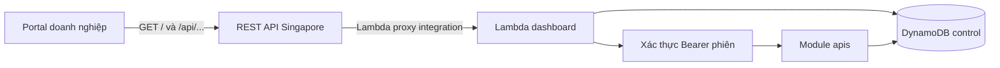

# Cấu trúc dự án và hướng dẫn tích hợp

Cập nhật: 17/10/2026. Portal và monitoring đã gộp vào một frontend React trong `monitoring-web/`; Lambda dashboard chỉ phục vụ API. Hướng sản phẩm hiện tại: doanh nghiệp đăng ký backend đích, lấy API key và gọi qua gateway của nền tảng; proxy và telemetry chưa triển khai.

## 1. Trạng thái và tài liệu cần dùng

Theo xác nhận của Tùng, đã hoàn thành đến **bước 5 của hướng dẫn triển khai**: tạo/cấu hình Lambda `mrapi-dashboard` tại Singapore, sau các bước bảng, role và đóng gói. Đây là trạng thái người thực hiện báo cáo; chưa có kết quả agent kiểm thử AWS thật.

Việc tiếp theo: test Lambda → tạo REST API → deploy stage → mở portal → test đăng ký/API đích → chạy e2e.

Tài liệu ưu tiên:

1. [GATEWAY_DESIGN.md](GATEWAY_DESIGN.md): ý tưởng, contract, schema và giới hạn hướng mới.
2. [FIRST_FOUR_PARTS.md](runbooks/FIRST_FOUR_PARTS.md): triển khai tài khoản và đăng ký API.
3. Tài liệu này: cấu trúc repo và điểm nối giữa các phần.
4. [BASE_SETUP.md](BASE_SETUP.md): thao tác base IAM/Budget/SNS.

Các tài liệu kế hoạch/thiết kế orders cũ đã được xóa. Dùng GATEWAY_DESIGN.md và FIRST_FOUR_PARTS.md cho hướng hiện tại. Không thay đổi tài nguyên AWS trong đợt dọn repo.

## 2. Cây thư mục

```text
aws/
├── README.md
├── .gitignore
├── src/
│   ├── package.json
│   ├── package-lock.json
│   ├── dashboard/
│   │   ├── index.mjs
│   │   └── apis.mjs
│   ├── authorizer/index.mjs
│   ├── api/index.mjs
│   ├── monitoring/README.md
│   └── shared/lib.mjs
├── monitoring-web/
│   ├── package.json, package-lock.json
│   ├── .env.example
│   ├── index.html, vite.config.ts, tsconfig.json
│   ├── src/
│   │   ├── main.tsx, App.tsx, index.css, vite-env.d.ts
│   │   ├── app/
│   │   ├── components/
│   │   ├── pages/
│   │   ├── data/mock/
│   │   ├── domain/
│   │   └── test/
│   └── docs/integration/
├── config/
│   ├── README.md
│   ├── project.example.json
│   └── demo/
│       ├── global.json
│       ├── ap-southeast-1.json
│       └── ap-northeast-1.json
├── infra/
│   ├── iam/                       # Đã chuẩn bị; chờ JSON từ Console
│   │   ├── policies/
│   │   ├── trust/
│   │   └── roles/
│   ├── dynamodb/
│   ├── lambda/
│   ├── apigateway/
│   ├── route53/
│   ├── s3/
│   └── monitoring/
├── scripts/
│   ├── package-lambdas.mjs
│   └── check-region-parity.mjs
├── tests/
│   ├── control-plane/portal.test.mjs, health.test.mjs
│   ├── e2e/control-plane.mjs
│   ├── security/
│   ├── replication/
│   └── failover/
├── docs/
│   ├── tài liệu thiết kế, hướng dẫn và kế hoạch
│   ├── runbooks/
│   ├── reports/progress/
│   └── evidence/
└── artifacts/
    ├── lambda/                    # ZIP sinh ra khi đóng gói
    └── checks/                    # File kiểm tra tạm nếu có
```

Thư mục có README chưa đồng nghĩa đã có chức năng. `src/monitoring`, nhiều thư mục infra và tests hiện mới là nơi dành sẵn cho triển khai sau.

## 3. Backend: `src/`

| File/thư mục | Vai trò | Trạng thái/điểm tích hợp |
|---|---|---|
| `dashboard/index.mjs` | Handler portal, tài khoản, phiên, key cũ, usage cũ, trạng thái Region | Gọi module apis sau khi xác thực phiên |
| `dashboard/apis.mjs` | Đăng ký/liệt kê/xem/sửa/bật/tắt API đích | Dùng tenant từ phiên; đọc/ghi API config trong control |
| `monitoring-web/src/pages/PortalPage.tsx` | Cổng doanh nghiệp trong frontend React dùng chung | Gọi API của Lambda dashboard; token Bearer trong sessionStorage |
| `authorizer/index.mjs` | Xác thực key hiện tại từ bảng control | Chưa có quyền key theo apiId; cần nâng cấp trước khi mở proxy |
| `api/index.mjs` | Health đọc bảng control, hỗ trợ giả lập health lỗi | Chưa có proxy; code orders đã bỏ |
| `monitoring/` | Backend đọc metric cho giao diện giám sát | Chưa có index.mjs, chưa deploy được |
| `shared/lib.mjs` | DynamoDB client, response, parse body, key/hash, region, biến môi trường | Các Lambda import tương đối; sửa có thể ảnh hưởng nhiều Lambda |
| `package.json` / lockfile | Dependency và lệnh backend | Chạy npm ci tại src để cài đúng bản trong lockfile |

### Quan hệ import

```text
dashboard/index.mjs
    ├── ./apis.mjs
    └── ../shared/lib.mjs
dashboard/apis.mjs ──► ../shared/lib.mjs
authorizer/index.mjs ──► ../shared/lib.mjs
api/index.mjs ──► ../shared/lib.mjs
```

Portal đã chuyển sang React; ZIP dashboard không còn cần file HTML. Không đổi vị trí shared mà không sửa đường dẫn và script đóng gói.

### Không nhầm hai loại key/token

| Giá trị | Ai dùng | Chức năng |
|---|---|---|
| Token phiên, header Authorization: Bearer | Người dùng portal | Quản lý tài khoản/API config |
| API key, header x-api-key | Backend/ứng dụng doanh nghiệp | Gọi proxy sau khi phần key scope/proxy được triển khai |
| IAM role | Lambda và dịch vụ AWS | Truy cập DynamoDB, log, metric theo policy |

Không gắn authorizer API key vào route đăng ký/đăng nhập. Không đưa AWS credentials hoặc key bí mật vào frontend công khai.

## 4. Một frontend dùng chung: `monitoring-web/`

### Cổng doanh nghiệp: `/portal`

React dùng chung Layout/sidebar/theme với monitoring. Dùng token trong sessionStorage; cấu hình `VITE_PORTAL_API_URL` khi build hoặc `PORTAL_API_TARGET` để proxy lúc dev.

Với backend `https://API_ID.execute-api.ap-southeast-1.amazonaws.com/demo`, client gọi `/demo/api/signup`, `/demo/api/apis`… Frontend tĩnh cần CORS: `PORTAL_ALLOWED_ORIGIN` trên Lambda và method OPTIONS ở API Gateway. Xem README frontend để cấu hình đầy đủ.

Portal có tài khoản, API đích, key, usage và trạng thái region qua `/api/status`. Key scope/proxy/telemetry chưa triển khai. `GET /` ở Lambda chuyển tới frontend `/portal` khi có `FRONTEND_URL`; nếu không, trả JSON thông tin service.

### Dashboard giám sát: `monitoring-web/`

| Thư mục/file | Vai trò |
|---|---|
| `main.tsx` | Khởi tạo React |
| `App.tsx` | Ghép ứng dụng và routing giao diện |
| `app/data.tsx`, `app/settings.tsx` | Context dữ liệu/cài đặt |
| `components/` | Layout, toolbar, chart và thành phần UI |
| `pages/` | Portal, Overview, Regions, APIs, Incidents, Sources, Settings |
| `portal/client.ts` | HTTP client của portal, sessionStorage và lỗi kết nối |
| `data/provider.ts`, `providers.ts`, `sources.ts` | Lớp lấy dữ liệu và nguồn dữ liệu |
| `data/mock/generator.ts` | Dữ liệu mẫu; không coi là kết quả AWS thật |
| `domain/` | Kiểu dữ liệu, định dạng, time range và tính trạng thái |
| `test/` và các file `.test.*` | Thiết lập và test frontend |
| `.env.example` | Mẫu biến cấu hình, không chứa secret |
| `docs/integration/` | Contract monitoring và hướng dẫn từng nguồn AWS |

Contract monitoring hiện có ở [backend-api.md](../monitoring-web/docs/integration/backend-api.md). Khi thêm metric gateway/API đích, cập nhật contract và types trước rồi nối backend/provider; không tự tạo response khác ở mỗi phía.

Chạy frontend từ gốc repo:

```powershell
npm ci --prefix monitoring-web
npm run dev --prefix monitoring-web
```

Kiểm tra:

```powershell
npm test --prefix monitoring-web
npm run build --prefix monitoring-web
```

Backend monitoring chưa tồn tại. Việc đặt `VITE_MONITORING_API_URL` không tự tạo backend. Đọc README frontend để chuyển từ DEMO DATA sang dữ liệu thật.

## 5. `config/`: thông tin tài nguyên đã bàn giao

| File | Nội dung |
|---|---|
| `project.example.json` | Mẫu cấu hình Region |
| `demo/global.json` | Project, domain, hosted zone và ARN role toàn cục |
| `demo/ap-southeast-1.json` | Bảng/Lambda/API/stage/base URL/bucket Singapore |
| `demo/ap-northeast-1.json` | Thông tin tương ứng Tokyo |

**Các Lambda hiện không tự đọc file config.** Bạn dùng config để bàn giao và đặt environment variables trên Console. E2E đọc baseUrl, script parity đọc tên Lambda và Region. Sửa config không tự cập nhật AWS.

Config đã bỏ bảng orders và receiptsBucket. Control plane dùng mrapi-control; schema telemetry/S3 export sẽ được bổ sung khi chốt thiết kế.

Sau bước 5 đã làm, ghi ARN role và tên Lambda thực tế. Khi tạo API Gateway, điền `apiId`, `stage`, `baseUrl` gồm stage và không có dấu / cuối. Ô trống là chưa bàn giao, không đoán giá trị.

## 6. `infra/`: cấu hình để dựng lại AWS

| Thư mục | Lưu nội dung gì |
|---|---|
| `iam/policies/` | Policy base MFA, region, developer IAM/services, boundary |
| `iam/trust/` | Trust policy dịch vụ nào được assume role |
| `iam/roles/` | Policy quyền thực tế của từng role; đã có thư mục bàn giao, chờ JSON thực tế từ Console |
| `dynamodb/` | Tên bảng, PK/SK, capacity, TTL, Global Tables và thao tác kiểm tra |
| `lambda/` | Runtime, handler, role, memory/timeout, env, version code |
| `apigateway/` | Resource/method → integration, authorizer, stage, CORS |
| `route53/` | Hosted zone, record, health check, ACM/custom domain tham chiếu |
| `s3/` | Bucket, public access, versioning, replication, lifecycle, export log |
| `monitoring/` | CloudWatch dashboard/alarm, SNS, nguồn metric |

`infra/iam/` đã được tạo để lưu bản sao policy/trust/role từ Console; hiện chưa có JSON thực tế. Không mở các đường dẫn JSON IAM cũ; xem BASE_SETUP và policy tham khảo trong FIRST_FOUR_PARTS hoặc xuất từ Console.

`infra/` hiện không phải Terraform/CDK và không có lệnh deploy tự động. JSON/README là tài liệu/cấu hình để người làm dựng bằng Console. Khi thao tác xong phải cập nhật cấu hình tại đây, không chỉ gửi ảnh hoặc tên tài nguyên trong chat.

Phân biệt:

- Trust policy: Lambda có được dùng role hay không.
- Permission policy: role được đọc/ghi gì.
- Boundary: trần quyền của role, không tự cấp quyền.
- Lambda resource policy: API Gateway có được invoke function hay không.

## 7. `scripts/` và `artifacts/`: đóng gói và kiểm tra

Chạy từ `D:\BTL\aws`:

```powershell
npm ci --prefix src
npm test --prefix src
npm run package --prefix src
```

`package-lambdas.mjs` tạo ZIP riêng cho api/dashboard/authorizer, thêm shared và dependency production. Monitoring bị bỏ qua cho đến khi có index.mjs.

ZIP dashboard có cấu trúc:

```text
dashboard.zip
├── dashboard/index.mjs
├── dashboard/apis.mjs
├── shared/lib.mjs
├── node_modules/...
└── package.json
```

Handler trên Lambda: **dashboard/index.handler**. Không đặt index.handler cho ZIP này. Thay code rồi phải đóng gói/upload lại; thay route/integration thì deploy lại API stage.

`check-region-parity.mjs` dùng AWS CLI đã xác thực, đọc cấu hình Lambda hai Region và so sánh hash/runtime/handler/role/env. Không kiểm tra route, key scope, schema hoặc failover. Chỉ chạy khi hai Region đã triển khai đầy đủ tên function trong config.

`artifacts/` chứa ZIP hoặc file kiểm tra sinh ra, được gitignore. Không dùng ZIP làm nguồn code chính để sửa rồi bỏ quên src.

## 8. `tests/`: kiểm thử nào chạy ở đâu?

| Test | Lệnh | Môi trường và giới hạn |
|---|---|---|
| Control plane local | npm test --prefix src | DynamoDB giả lập trong bộ nhớ; không chứng minh AWS hoạt động |
| Control plane AWS | npm run test:e2e --prefix src | API thật từ config/base URL; tạo tài khoản/API test, giữ dữ liệu và tắt API khi thành công |
| Security/replication/failover | Chưa có script hoàn chỉnh | README là chỗ dành sẵn; bổ sung test thực tế sau |

E2E control plane kiểm tra signup/login, email trùng, tạo/sửa/tắt API, tenant chéo 404, URL sai 400, logout và token bị từ chối. Nếu script lỗi giữa chừng, dữ liệu/phiên thử có thể còn; kiểm tra và dọn sau.

## 9. `docs/`: tài liệu và bằng chứng

| Vị trí | Nội dung |
|---|---|
| `GATEWAY_DESIGN.md` | Thiết kế hướng mới, contract và schema |
| `MEMBER_LOGIN_MFA.md` | Thành viên đăng nhập AWS |
| `runbooks/FIRST_FOUR_PARTS.md` | Tùng triển khai control plane Singapore |
| `runbooks/` | Quy trình triển khai bốn phần đầu và dọn dẹp |
| `reports/first-four-parts.md` | Trạng thái bàn giao và chỗ điền bằng chứng AWS |
| `reports/progress/Bao_cao_tien_do.docx` | Báo cáo tiến độ đã chuyển khỏi gốc repo |
| `evidence/` | Ảnh/output/log đã che secret, ghi thời điểm và Region |

README gốc là điểm vào tài liệu. `.gitignore` chặn node_modules, dist, artifacts, env/credentials và một số file nhạy cảm; vẫn phải tự kiểm tra secret trước commit vì gitignore không phát hiện token trong nội dung file.

## 10. Luồng tích hợp đang triển khai



Các route cần cho giai đoạn này:

| Resource/method API Gateway | Integration | Xác thực |
|---|---|---|
| GET / | mrapi-dashboard | NONE |
| ANY /api/{proxy+} | mrapi-dashboard | NONE tại API Gateway; Lambda kiểm tra phiên cho route riêng tư |

`/api/{proxy+}` ở đây là catch-all **portal**, không phải chức năng chuyển tiếp tới backend doanh nghiệp.

### Checklist điểm nối

1. **Bảng ↔ Lambda:** env CONTROL_TABLE đúng tên; policy có ARN đúng Region/account/table.
2. **ZIP ↔ Lambda:** handler dashboard/index.handler, có apis/shared/dependency; frontend build riêng.
3. **API Gateway ↔ Lambda:** REST proxy integration, đúng function, có resource permission invoke.
4. **Stage ↔ frontend:** cấu hình URL API có /demo, CORS/OPTIONS nếu khác origin; route đổi phải deploy lại.
5. **Phiên ↔ API đích:** request quản trị có Bearer; tenant chỉ lấy từ phiên; tenant chéo trả 404.
6. **Config ↔ E2E:** baseUrl đúng API/stage; kiểm tra bằng response thật.

### Tiếp tục từ bước 5 Tùng đã hoàn thành

1. Lambda Test: `{"httpMethod":"GET","path":"/","headers":{}}` → 200 và HTML.
2. Lambda Test: `{"httpMethod":"GET","path":"/api/me","headers":{}}` → 401 vì chưa có phiên.
3. Tạo REST API/resource/method theo bảng trên; deploy stage demo.
4. Điền URL vào config, mở portal, thử signup và tạo/sửa/bật/tắt API.
5. Chạy e2e AWS và lưu output vào reports/evidence. Một test local PASS không thay thế bước này.

## 11. Điểm tích hợp cho giai đoạn gateway tiếp theo

```text
Backend doanh nghiệp
    → Route 53/domain chung
    → API Gateway Region
    → Authorizer: key + tenant + apiId được phép
    → Lambda proxy: lấy API config → kiểm tra enabled/đích → chuyển tiếp
    → Backend đích
    → trả status/body + ghi nhận request/latency/error/region
```

Thứ tự làm:

1. Mở rộng key config với scope API và chốt migration key cũ; không mặc định coi key cũ truy cập mọi API.
2. Authorizer kiểm tra key/scope; proxy tra API config bằng tenant/apiId, không nhận URL đích tự do từ client.
3. Thay nghiệp vụ trong src/api hoặc tạo module proxy rõ ràng; cập nhật package/config/tests/infra tương ứng.
4. Trước khi kết nối backend: kiểm tra DNS/IP IPv4/IPv6 tại kết nối, chống private/link-local/loopback/reserved/rebinding; kiểm soát redirect, header, payload và timeout. Validation URL lúc đăng ký chưa đủ.
5. Chốt schema telemetry, ghi lỗi/latency/API/endpoint; không ghi body/credentials mặc định. Phân biệt backend error, timeout, connection error, gateway error.
6. Portal hiển thị thống kê theo API; monitoring backend phục vụ sức khỏe hạ tầng và metric gateway, contract đồng bộ với frontend.
7. Deploy Tokyo cùng code, Global Tables dữ liệu cần thiết; test replication trước DNS/failover.
8. S3 nếu đề bài yêu cầu: dùng export log/báo cáo, thay khái niệm receipts; chốt config/replication/lifecycle mới.

## 12. Quy tắc bàn giao để dễ tích hợp

Owner, phạm vi, điểm nối và mốc nghiệm thu chỉ được quy định tại [WORK_ASSIGNMENT.md](WORK_ASSIGNMENT.md). Tài liệu này mô tả cấu trúc và cách tích hợp, không phải bản phân công riêng.

- Một bản code dùng cho hai Region, cấu hình khác nhau ở env/config; không tách src/singapore và src/tokyo.
- Mỗi thay đổi contract phải cập nhật caller, handler, test và hướng dẫn trong cùng PR.
- Code Lambda sửa trong repo rồi đóng gói; tránh sửa Console mà không đưa về repo.
- Bàn giao đủ commit, file, ARN/URL, env/handler, route, quyền, output test và lỗi còn lại.
- Không có secret trong config, report hoặc ảnh; xác thực AWS bằng user/role hợp lệ.
- Nhãn DONE cần kiểm tra thực tế và reviewer; folder/README/mock chưa phải kết quả triển khai.


